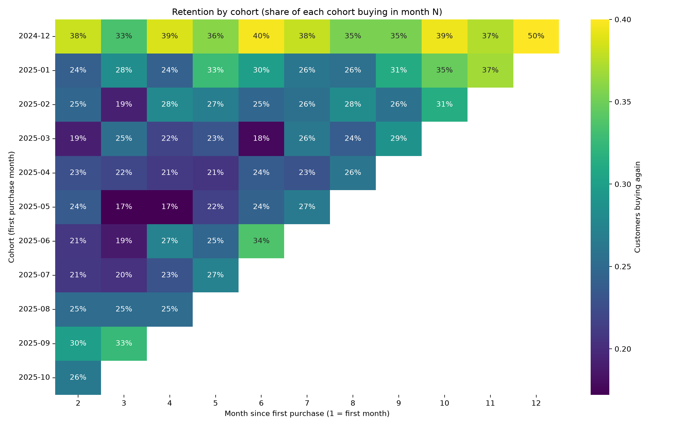
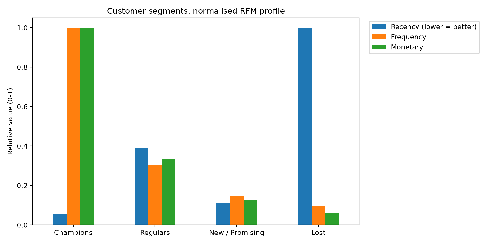

# SkyRun Customer Retention Analysis

Cohort analysis and customer segmentation for SkyRun Inc., an online retailer that attracts plenty of new customers but struggles to get them to buy again.

**[Read the full report (PDF)](report/SkyRun_Customer_Retention_Report.pdf)**

## The question

When do customers stop buying after their first purchase? Is retention getting worse for newer customers? And which groups of customers should SkyRun focus on to improve loyalty?

## Data

About 541,900 transaction lines from 1 December 2024 to 9 December 2025, covering invoices, dates, customer IDs, products, quantities and prices. After removing rows without a customer ID, the analysis covers 4,372 customers and 22,190 orders.

The dataset is not included in this repository. To run the notebook, place `Skyrun dataset.csv` in the same folder as the notebook.

## Approach

1. **Data cleaning and checks:** missing customer IDs, duplicates, returns, and whether country and product category could be used
2. **Cohort analysis:** customers grouped by their first purchase month and tracked month by month
3. **Fair comparisons:** cohorts compared at the same age (month 2, 4 and 7 retention, 3-month return rate, 6-month value)
4. **Drop-off and churn:** time to second purchase and a churn threshold based on the data
5. **Segmentation:** RFM (recency, frequency, monetary) with K-Means clustering

## Key findings

- **Most customers are lost after their first order.** Only about 25% of new customers buy again in the following month, and around half have not returned after three months.
- **Retention is low, but not getting worse.** Month-2 retention stayed between 19% and 30% across cohorts, with no steady decline.
- **There is a clear window to act.** Returning customers came back after a median of 41 days, and 71% returned within 90 days.
- **Value is concentrated.** 18% of customers (Champions) generate 57% of revenue, while the largest group (35%) has stopped buying.





## Recommendations

1. Build a second-order programme for new customers in their first 30 to 45 days.
2. Re-engage customers who have not bought for 90 days.
3. Protect the Champions with loyalty rewards and priority service.
4. Keep win-back campaigns for lost customers low-cost.

## Repository contents

| File | Description |
|---|---|
| `skyrun_retention_analysis.ipynb` | Full analysis notebook |
| `report/SkyRun_Customer_Retention_Report.pdf` | Project report with findings and recommendations |
| `figures/` | Charts produced by the notebook |
| `requirements.txt` | Python packages needed |

## How to run

```bash
pip install -r requirements.txt
jupyter notebook skyrun_retention_analysis.ipynb
```

Then run all cells. Charts are saved to the `figures/` folder.

## Tools

Python, pandas, NumPy, Matplotlib, Seaborn, scikit-learn